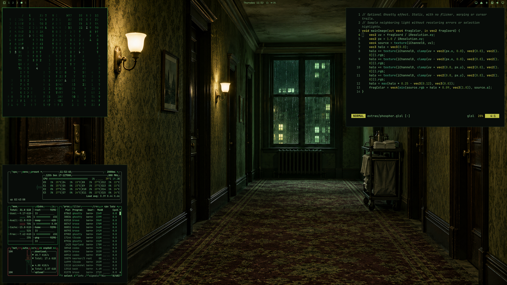

# Matrix

An Omarchy 4 theme for the 1999 film: phosphor green on void black, with olive
shadows and a restrained CRT-green accent (`#3CBF5C`).



Real Omarchy 4.0.6 desktop at **3840×2160** and **150% display scaling**.
Hotel Corridor sits behind terminal rain, Neovim with the optional phosphor
shader, and themed btop. The windows were arranged for the screenshot;
installing the theme does not start terminal rain.

## Install

```sh
omarchy theme install https://github.com/BVisagie/omarchy-matrix-theme
```

Or open **Install > Style > Theme** in the Omarchy menu (`Super + Space`).
Cycle backgrounds with `Super + Ctrl + Space`.

**Installed before the October 22, 2026 cleanup?** Back up any edits inside
`~/.config/omarchy/themes/matrix`, then run the install command once again.
It replaces that directory with a fresh checkout. The repository history was
restarted to remove old artwork from every new download; an older checkout
cannot update to it with a normal `git pull`. Personal backgrounds stored in
`~/.config/omarchy/backgrounds/matrix/` are separate from the replaced directory.

## Wallpapers

Six JPEGs at **3840×2160**, with **Hotel Corridor** first:

1. **Hotel Corridor** — worn wallpaper, timber doors, brass sconces, and a rainy end window.
2. **Falling Code** — the original dense, layered green glyph streams.
3. **Mono Rain** — the original silver rendition of the same glyph composition.
4. **Green Street** — an empty intersection and wet-road reflections.
5. **The Office** — one active CRT beside a dark cubicle aisle.
6. **After Hours** — a back-office corridor, tired fluorescents, and a partly hidden CRT.

Hotel is selected on a fresh install without personal-background overrides.
Reapplying an active theme can advance to the next image.

The four cinematic scenes are **AI-upscaled artworks**: original 1672×941 generations were processed
with SeedVR2 at 4×, then exported from 6688×3764 masters as sRGB, quality-95
JPEGs with 4:4:4 chroma. Falling Code and Mono Rain retain their exact original
native 4K files from before the overhaul, without regeneration or recompression.
Both are included in the normal wallpaper cycle. The
[provenance manifest](PROVENANCE.json) records hashes and sources.
The desktop screenshot is a real screen capture.

Optional artwork is downloaded separately from [the release](https://github.com/BVisagie/omarchy-matrix-theme/releases/tag/v1.0.0):

- [6K cinematic wallpapers](https://github.com/BVisagie/omarchy-matrix-theme/releases/download/v1.0.0/matrix-wallpapers-6k.zip) — 6144×3456 companions.
- [Experimental code-rain variants](https://github.com/BVisagie/omarchy-matrix-theme/releases/download/v1.0.0/matrix-code-rain-4k-8k.zip) — the later sparse redesigns at native 4K and 8K, distinct from the original compositions bundled here.
- [Original artwork and generation records](https://github.com/BVisagie/omarchy-matrix-theme/releases/download/v1.0.0/matrix-artwork-sources.zip).
- [SHA-256 checksums](https://github.com/BVisagie/omarchy-matrix-theme/releases/download/v1.0.0/SHA256SUMS).

Extract your chosen images and copy them into
`~/.config/omarchy/backgrounds/matrix/` to add them to your personal cycle.

## Operator terminal

An optional terminal profile is included. From the installed theme directory:

```sh
cd ~/.config/omarchy/themes/matrix
./scripts/matrix-terminal
./scripts/matrix-terminal --terminal foot
./scripts/matrix-terminal --font-size 12
./scripts/matrix-terminal --phosphor
./scripts/matrix-terminal -- btop
./scripts/matrix-greeting
```

Requires Python 3.11+, Ghostty or Foot, and JetBrainsMono Nerd Font. The default
is a separate Ghostty instance with 11pt type, extra padding, an opaque
background, and a steady block cursor. Colors come directly from `colors.toml`.
Your terminal configuration and shell startup files are preserved.

`--phosphor` adds a small static Ghostty glow without flicker or an animation
loop. Foot uses the clean profile. The companion Starship prompt is scoped to
the launched process; SSH hosts, root sessions, and failed commands remain
identifiable. Close the window to return to your normal profile.

## What it themes

The palette and `shell.*.toml` files style the Omarchy shell, bar, menus,
notifications, launcher, and lock input. Omarchy generates terminal palettes,
Neovim, Helix, VS Code, Obsidian, btop, browser colors, and the Hyprland active
border from `colors.toml`. Icons use `Yaru-olive-dark`; keyboard RGB is `3CBF5C`.

Panels are opaque near-black, selected rows use green, and keyboard focus gets
a distinct border. User font scaling and global shell overrides remain in
effect. No Hyprland behavior or shell plugins are installed.

The lock input is themed; a custom lock design or animated lock-screen rain
is not bundled. Earlier lock-screen images used a separate custom design.
Compatibility targets **Omarchy 4 / Quickshell**. Omarchy 3 is not covered.

## Keeping the download small

The theme checkout is about **20.5 MiB**, including the full-resolution desktop
preview and all six wallpapers. CI enforces a **21 MiB tracked-file budget**
and a **25 MiB Git pack budget**, including ordinary branches and tags.

Source art, experiments, comparisons, rendering tools, and earlier Git history
live in the separate [development archive](https://github.com/BVisagie/omarchy-matrix-theme-archive).
Large optional files are release attachments, so normal theme installation
does not download them. Keep future production material there as well.

## Validation

With Python 3.11+, Pillow, and `glslangValidator` installed:

```sh
python3 -m unittest discover -s tests -v
python3 scripts/check-size --history
./scripts/matrix-terminal --check
./scripts/matrix-terminal --terminal foot --check
./scripts/matrix-terminal --phosphor --check
```

The history check requires a full clone. Tests cover the six-wallpaper cycle,
Hotel-first ordering, image dimensions and provenance, palette contrast,
shell colors, terminal argument handling, and shader compilation.

## License

MIT. Cinematic stills are original generations; code rain is original
code. The unlock mark is the Omarchy geometry recolored to phosphor green.
